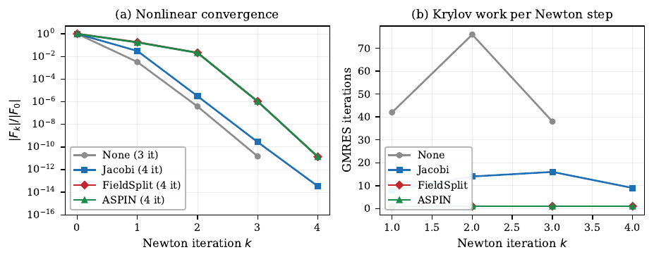
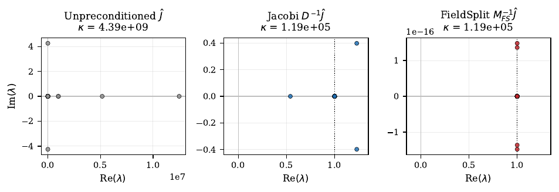
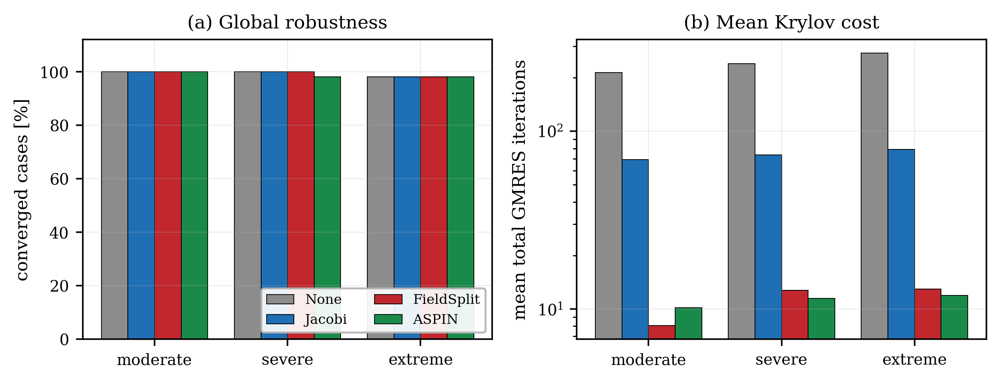
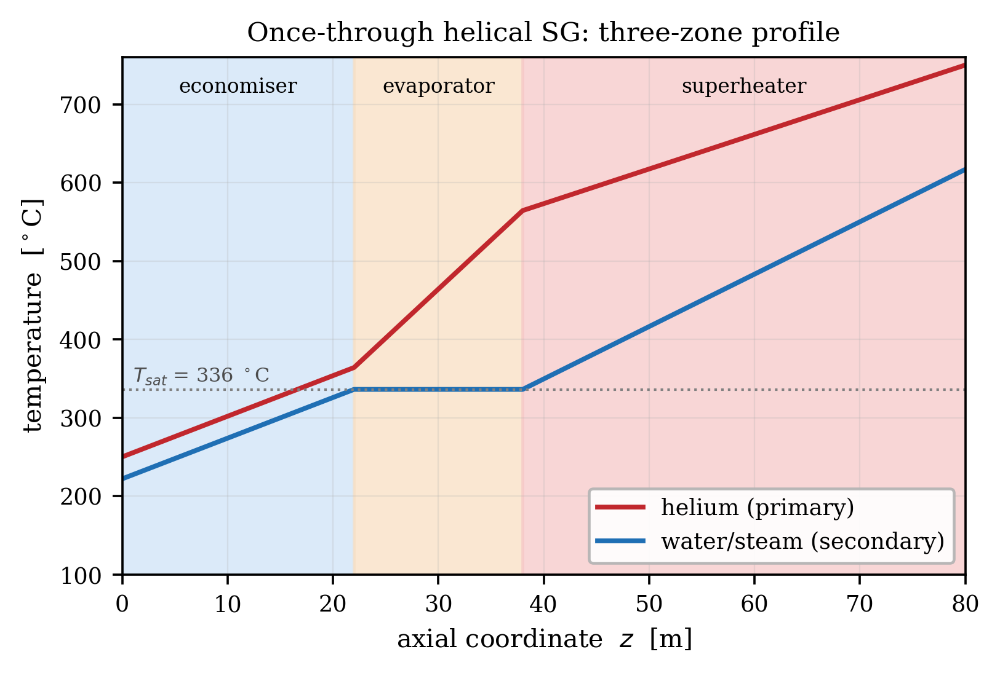
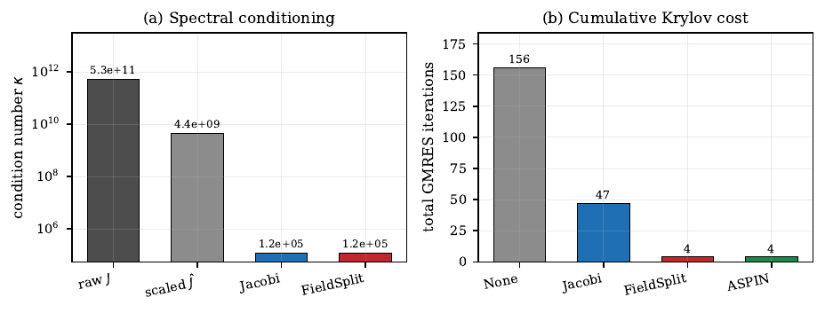
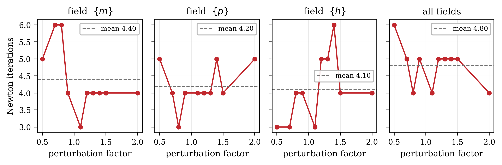
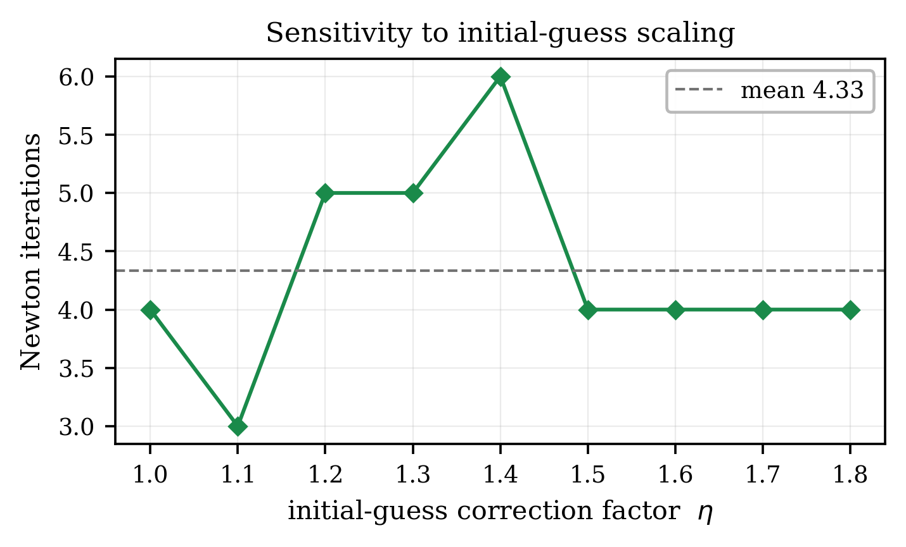
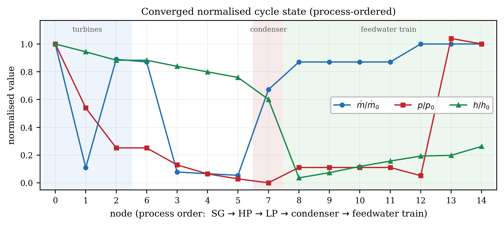
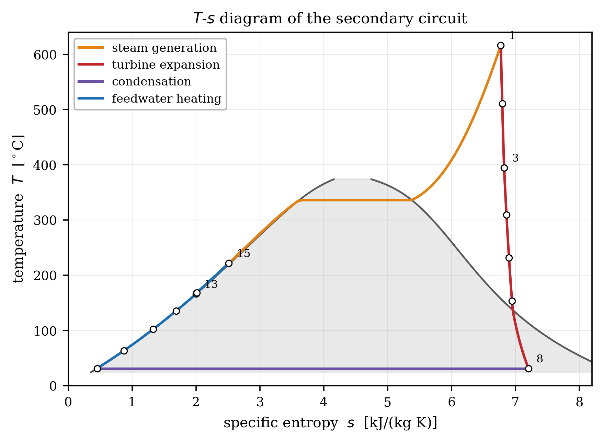
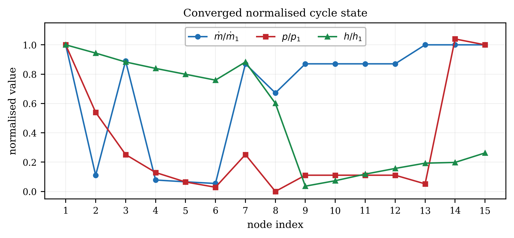

# HTR-PM-JFNK

**A physics-based preconditioned Jacobian-free Newton–Krylov solver for the steady-state secondary (steam) circuit of the HTR-PM high-temperature gas-cooled reactor power plant.**

   -success)

This repository is the reference implementation accompanying our paper, *Physics-Based Preconditioning of a Jacobian-Free Newton–Krylov Solver for the HTR-PM Secondary Circuit* (see citation details below). It contains the complete solver (one self-contained Python file), the full console output of a reference run, and every figure in the paper's results section, all regenerated by a single command.

---

## Contents

1. [Purpose](#purpose)
2. [Scientific novelty](#scientific-novelty)
3. [The model at a glance](#the-model-at-a-glance)
4. [Key results](#key-results)
5. [Getting started](#getting-started)
6. [Using the code as a library](#using-the-code-as-a-library)
7. [Code map](#code-map)
8. [Reproducibility notes and known limitations](#reproducibility-notes-and-known-limitations)
9. [How to extend this work (ideas for new publications)](#how-to-extend-this-work-ideas-for-new-publications)
10. [Citation](#citation)
11. [License](#license)

---

## Purpose

The HTR-PM is a 2 × 250 MWth pebble-bed high-temperature gas-cooled reactor. Heat from the helium primary loop is transferred in once-through helical steam generators (SGs) to a regenerative Rankine secondary cycle: HP/LP turbines, three LP closed feedwater heaters, a direct-contact deaerator, an HP heater, and condensate and feedwater pumps.

Finding the *steady state* of this circuit means solving a strongly coupled, nonlinear system. Mass, pressure, enthalpy and the SG heat-transfer model all interact, and the system also contains phase changes (wet-steam expansion, saturation at the deaerator, boiling in the SG). Such networks are the basis of plant design, off-design analysis, transient initialisation and digital twins, so the steady-state solve has to be **robust** (converge from poor initial guesses) and **cheap** (it is called many times in parametric studies).

This code does three things:

- **Solves the steady-state secondary circuit** (50 unknowns) with a Jacobian-free Newton–Krylov (JFNK) method, using Eisenstat–Walker forcing terms and Armijo backtracking.
- **Compares four preconditioning strategies** on exactly the same physics: none, point-Jacobi, a physics-based *Field-Split* preconditioner, and *ASPIN* (Additive-Schwarz Preconditioned Inexact Newton).
- **Reproduces and extends a published benchmark.** The cycle is checked against the HTR-PM secondary-circuit reference state of Jiang et al., *Energies* 2023, 16, 2252 (their Table 2).

## Scientific novelty

1. **Physics-based preconditioning for thermo-hydraulic networks.** Instead of treating the Jacobian as an anonymous matrix, the unknowns are partitioned into four *physical fields*: mass flow **M**, pressure **P**, enthalpy **H** and steam generator **SG**. A Field-Split (block-Jacobi) preconditioner inverts each field block exactly. Cross-field coupling is dropped and left to GMRES.
2. **ASPIN with six physics-motivated subdomains**, for example HP turbine, LP turbine, LP heaters, DA/FW/HPH train, LP mass flows and steam generator. Each subdomain runs local Newton sweeps with its interface frozen, as a *nonlinear* preconditioner. The sweep is safeguarded so that it is accepted only if it lowers the global residual, which removes spurious fixed points of the additive-Schwarz map.
3. **A well-posed, non-redundant SG block.** The three-zone (economiser / evaporator / superheater) once-through helical SG adds five equations (UA·LMTD per zone and zone lengths). The steam outlet enthalpy becomes an *output* of the heat-transfer model rather than a fixed boundary condition. Every unknown is the sole subject of exactly one equation (structural regularity), so the Jacobian is non-singular.
4. **Exact IAPWS-IF97 property layer** (Regions 1, 2 and 4) written from scratch, with an entropy-based isentropic expansion that handles wet-steam turbine stages. It uses exact isentropic pump work and exact compressed-liquid and superheated-vapour T(P,h) inversions, with no polytropic or constant-c_p approximations. It is checked against IF97 reference values at start-up (see the console output).
5. **A quantitative study of the preconditioned operator**: spectra, condition numbers and field-block conditioning, plus a randomised 3-band robustness study (150 starts per preconditioner) and a systematic sensitivity study, all in one reproducible script.

## The model at a first glance

| Item | Value |
|---|---|
| Unknowns | 50 = 15 mass flows + 15 pressures + 15 enthalpies + 5 SG variables (`l_pre`, `l_eva`, three helium temperatures) |
| Main circuit | 15-node regenerative Rankine cycle, 2 HP + 4 LP turbine control volumes, 3 LP heaters, DA, HP heater, 2 pumps |
| Plant | 2 × 250 MWth, 192 kg/s helium (750 → 250 °C), 186 kg/s steam at 13.9 MPa |
| Nonlinear solver | Inexact Newton + GMRES (matrix-free `J·v` by finite differences), Eisenstat–Walker forcing, Armijo line search |
| Preconditioners | `None`, `Jacobi`, `FieldSplit`, `ASPIN` |

## Key results

All numbers below come from a full run of `htr_jfnk_v9.3.py`. The complete console output of the original run is in [`output-v9.3.txt`](output-v9.3.txt).

**Converged cycle** (SG outlet 13.9 MPa / 616.9 °C):

| Quantity | Value |
|---|---|
| Gross mechanical power | 209.2 MW |
| Net electrical power | 205.5 MW |
| SG thermal duty | 498.5 MW |
| **Net cycle efficiency** | **41.2 %** |
| LP exhaust | 4.5 kPa, 31.0 °C, x = 0.847 |

**Solver comparison, single solve to ‖F/d‖ < 1e-10:**

| Preconditioner | Newton steps | Total GMRES iterations | Condition number of preconditioned operator |
|---|---|---|---|
| None | 3 | 156 | 4.4 × 10⁹ (scaled J) |
| Point-Jacobi | 4 | 47 | 1.2 × 10⁵ |
| **FieldSplit** | 4 | **4** | 1.2 × 10⁵ |
| **ASPIN** | 4 | **4** | n/a (same linear PC as FieldSplit) |

The Field-Split preconditioner cuts the Krylov cost by **roughly 30–40×** relative to the unpreconditioned solver (39× in the reference run, about 32× in a re-run with a newer SciPy; see the [reproducibility notes](#reproducibility-notes-and-known-limitations)). Its effect is on the **linear** work per Newton step (one GMRES iteration per step here), not on the number of Newton steps. The spectrum of the preconditioned operator collapses onto λ = 1, as the right-hand panel shows:

<p align="center">
  
</p>
<p align="center">
  
</p>

**Robustness (50 random starts per band, each variable multiplied by a log-uniform factor).**

| Band | None | Jacobi | FieldSplit | ASPIN |
|---|---|---|---|---|
| moderate [0.35, 2.8] | 50/50 | 50/50 | 50/50 | 50/50 |
| severe [0.15, 6.0] | 50/50 | 50/50 | 50/50 | 49/50 |
| extreme [0.05, 15] | 49/50 | 49/50 | 49/50 | 49/50 |

Mean GMRES iterations per solve are about 210–275 (None), 70–80 (Jacobi) and 8–13 (FieldSplit / ASPIN). The Field-Split and ASPIN preconditioners are 20–30× cheaper than no preconditioning at essentially identical convergence rates. In this study ASPIN gives slightly fewer Newton steps, but its basin of attraction is not measurably larger than FieldSplit's. This is an open question and an opportunity (see below).

<p align="center">
  
</p>

<details>
<summary><b>More figures (steam generator profile, conditioning, sensitivity, process-ordered state)</b></summary>

<p align="center">
  <br>
  <em>Three-zone once-through helical SG: helium (primary) vs water/steam (secondary).</em>
</p>
<p align="center">
  <br>
  <em>Conditioning of the Jacobian and of each physical field block.</em>
</p>
<p align="center">
  <br>
  <em>Newton steps vs. perturbation factor applied to the initial guess (m, p, h, all fields).</em>
</p>
<p align="center">
  <br>
  <em>Enthalpy-field correction-factor sweep (cf. Energies 2023, Table 5).</em>
</p>
<p align="center">
  <br>
  <em>Converged normalised state (ṁ/ṁ₀, p/p₀, h/h₀) in process order.</em>
</p>
<p align="center">
  <br>
  <em>T–s diagram of the cycle.</em>
</p>
<p align="center">
  <br>
  <em>Converged normalised state (ṁ/ṁ₁, p/p₁, h/h₁) by node index, in the paper's 1–15 node numbering.</em>
</p>

</details>

## Getting started

### Requirements

Python ≥ 3.9 with `numpy`, `scipy` and `matplotlib`. Nothing else is needed, and the IF97 property layer is implemented in the file itself. The reference results were produced with NumPy 2.5, SciPy 1.18 and Matplotlib 3.11, but other recent versions should work.

```bash
git clone https://github.com/nikola-m/htr-pm-jfnk.git
cd htr-pm-jfnk
pip install numpy scipy matplotlib
```

### Run everything (≈ 3 minutes, single core)

```bash
python htr_jfnk_v9.3.py
```

This performs, in order:

1. IF97 property verification against reference values.
2. Solve with each of the four preconditioners, followed by the converged cycle summary and a comparison with the published reference state.
3. Spectral analysis of the preconditioned Jacobian.
4. Field-block conditioning.
5. Robustness study (50 random starts × 3 bands × 4 preconditioners).
6. Sensitivity study and correction-factor sweep.
7. Figure rendering into `figs/` (3 PDF and 8 PNG files).

The robustness study dominates the run time. For a **~30 s smoke test**, use fewer random starts (8 instead of 50):

```bash
python htr_jfnk_v9.3.py --quick
```

Note that `--quick` overwrites the figures in `figs/` with the reduced-sample versions.

Save the console output with `python htr_jfnk_v9.3.py | tee output.md`.

## Using the code as a library

The file name contains a dot, so import it with `importlib`:

```python
import importlib.util

spec = importlib.util.spec_from_file_location("htr", "htr_jfnk_v9.3.py")
htr = importlib.util.module_from_spec(spec)
spec.loader.exec_module(htr)

# 1. Solve the steady-state secondary circuit with the Field-Split preconditioner
solver = htr.JFNKSolver(htr.FieldSplitPreconditioner(), tol=1e-10, verbose=True)
x, converged = solver.solve(htr.build_x0())

# 2. Post-process the 50-element state vector
R = htr.extract_results(x)
print(f"Net power  : {R['W_net']/1e6:.2f} MW")
print(f"Efficiency : {100*R['eta']:.2f} %")
print(f"SG lengths : pre {R['l_pre']:.1f} m, eva {R['l_eva']:.1f} m, sup {R['l_sup']:.1f} m")

# 3. Swap preconditioners
aspin = htr.JFNKSolver(htr.ASPINPreconditioner(nsub=3), tol=1e-10, use_aspin=True)
x2, ok = aspin.solve(htr.build_x0())

# 4. Solve from a badly scaled start (every variable perturbed by +/-50 %)
import numpy as np
rng = np.random.default_rng(0)
x_bad = htr.project_physical(htr.build_x0() * rng.uniform(0.5, 1.5, htr.N_DOF))
x3, ok = htr.JFNKSolver(htr.FieldSplitPreconditioner(), tol=1e-8).solve(x_bad)
```

`extract_results` returns a dictionary with the per-node arrays `m`, `p`, `h`, `T`, `x` (quality), plus `W_HP`, `W_LP`, `W_gross`, `W_pump`, `W_net`, `Q_in`, `eta`, the SG zone lengths and the helium temperature path `T_He`. Plant data (flows, pressures, efficiencies, extraction fractions, SG geometry) are plain module-level constants in *Section B* of the file, so a what-if study is a one-line change.

## Code map

Everything is in [`htr_jfnk_v9.3.py`](htr_jfnk_v9.3.py), organised in sections:

| Section | Contents |
|---|---|
| **A** | IAPWS-IF97 property layer: Region 1 / 2 / 4, T(P,h) and s(P,h) inversions, isentropic expansion, exact pump work |
| **B** | HTR-PM design data: flows, pressures, efficiencies, extraction fractions, SG geometry |
| **C** | SG calibration and physics-consistent initial guess `build_x0()` |
| **D** | The 50-equation residual `residual(x)` (mass, pressure, energy, SG blocks) |
| **E** | Residual scaling `DS` (makes every equation O(1)) |
| **F** | Preconditioners: `NonePreconditioner`, `JacobiPreconditioner`, `FieldSplitPreconditioner`, `ASPINPreconditioner`, plus the subdomain definitions `FIELD_BLOCKS`, `ASPIN_BLOCKS` |
| **G** | `JFNKSolver`: matrix-free Newton–Krylov with Eisenstat–Walker forcing, Armijo backtracking, trust region and recovery strategies |
| **H–I** | Spectral analysis, cycle post-processing, sensitivity studies |
| **J** | Publication figures |
| **K** | Robustness study and `main()` driver |

## Reproducibility notes and known limitations

- **Iteration counts are platform-sensitive.** GMRES iteration counts of the *unpreconditioned* and Jacobi runs depend slightly on the SciPy/BLAS version. A re-run with SciPy 1.18 gave 127 total GMRES iterations for the unpreconditioned solve (a 32× Field-Split reduction) versus 156 (39×) in [`output-v9.3.md`](output-v9.3.md). The Newton counts, converged cycle state, FieldSplit/ASPIN iteration counts and the robustness conclusions are unchanged. Wall-clock times vary with the machine.
- **Preconditioners cut Krylov work, not Newton steps.** The unpreconditioned solver needs 3 Newton steps against 4 for FieldSplit/ASPIN, but at ~40× the linear-algebra cost.
- **Preconditioner blocks are built from a dense finite-difference Jacobian** (50 residual evaluations per refresh). This is cheap at 50 DOF but would not scale unchanged to very large networks (see ideas below). Only the outer `J·v` products are matrix-free.
- **Agreement with the published reference state** (Energies 2023, Table 2) is excellent for mass flows and condensate-pump conditions (< 0.1 %). Larger deviations remain for the LP-exhaust enthalpy (−6.1 %) and the feedwater-pump outlet pressure and enthalpy (+3.6 %, +11.7 %), which shows where the model differs from the reference. The turbine isentropic efficiencies (0.92 / 0.88) are calibration parameters.
- **Wet-steam and Region 3 limits.** The cycle never exceeds 14.5 MPa and 340 °C in the liquid, so Region 3 of IF97 is not implemented. Supercritical applications would require it.
- **Pure-Python property evaluation** dominates the run time. The code is written for clarity and reproducibility, not for speed.


## Citation

If you use this code, please cite the accompanying paper.

### AMA Style:

Mirkov N, Ilić M, Škobalj P, Milošević D, Kljajić M. Physics-Based Preconditioning of a Jacobian-Free Newton–Krylov Solver for the HTR-PM Secondary Circuit. Journal of Nuclear Engineering. 2026; 7(4):67. https://doi.org/10.3390/jne7040067

### BiBTex:
```bibtex
@article{HTRPMJFNK,
AUTHOR = {Mirkov, Nikola and Ilić, Milica and Škobalj, Predrag and Milošević, Dušan and Kljajić, Miroslav},
TITLE = {Physics-Based Preconditioning of a Jacobian-Free Newton–Krylov Solver for the HTR-PM Secondary Circuit},
JOURNAL = {Journal of Nuclear Engineering},
VOLUME = {7},
YEAR = {2026},
NUMBER = {4},
ARTICLE-NUMBER = {67},
URL = {https://www.mdpi.com/2673-4362/7/4/67},
ISSN = {2673-4362},
ABSTRACT = {We present a mathematical framework and a numerical solution architecture for the steady-state secondary circuit of the HTR-PM power plant and use it to evaluate physics-based preconditioning for strongly coupled thermo-hydraulic networks. The governing equations are formulated as a non-linear algebraic system partitioned into four physical fields: mass flows, pressures, specific enthalpies, and the internal state of a three-zone once-through helical steam generator, whose economiser and evaporator lengths and helium interface temperatures are solved simultaneously with the cycle. Water and steam properties are evaluated from the IAPWS-IF97 Region 1 and Region 2 basic equations, with exact Newton inversions for all single-phase (P,h) and (P,s) states. The system is solved by a Jacobian-free Newton–Krylov (JFNK) method with an Eisenstat–Walker forcing term and Armijo backtracking. Two preconditioners are developed and compared: a field-split preconditioner formed by inverting the four physical field blocks, and an Additive Schwarz Preconditioned Inexact Newton (ASPIN) strategy that performs subdomain Newton sweeps over six physics-motivated subdomains. On the design case, field-split preconditioning needs a single GMRES iteration per Newton step, reducing the Krylov cost of a complete solve by a factor of more than 30 relative to the unpreconditioned iteration and about 12 relative to point Jacobi (diagonal) preconditioning, and it collapses the spectrum of the preconditioned operator onto λ=1, with max|Imλ| falling from 4.26 to below 10−9. The condition number alone does not distinguish field-split from point Jacobi; the discriminating property is eigenvalue clustering. In a randomised restart study, in which each component of the initial guess is perturbed by an independent log-uniform factor, field-split converges from 149 of 150 far-from-solution starts within 25 Newton steps, at 6-9 times lower Krylov cost than point Jacobi, and the remaining start converges when the budget is raised. ASPIN converges from 148 of 150 starts, including the only genuine stagnation observed. Our conclusions speak in favour of the physical rather than algebraic considerations for the development of preconditioners for strongly coupled thermal–hydraulics problems.},
DOI = {10.3390/jne7040067}
}
```

The benchmark reference state is from: Jiang, S.; Wu, Y.; Zhang, H.; Lixun, L.; Guo, J.; Li, F. *A Modified JFNK for Solving the HTR Steady State Secondary Circuit Problem*. **Energies** 2023, 16, 2252. https://doi.org/10.3390/en16052252

## License

Released under the [MIT License](LICENSE.txt).
